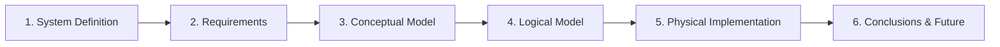

# ✈️🌍 JoseTrip — From Counter Gossip in Vizela to 3NF Glory

> *"Every trip was an incredible story... until it got lost in a phone gallery or forgotten at the agency counter."*  
> — **Mr. Josefino Ventura**, Founder & CEO of JoseTrip (probably)

Welcome to the official database repository for **JoseTrip**! Developed for the **Databases (Bases de Dados)** course at the **University of Minho** (2025/2026), this project takes a small travel agency in the heart of Vizela and catapults it into the digital age with a fully normalized, ACID-compliant relational database.

---

## 📖 The Lore: Why Does This Exist?

Meet **Mr. Josefino Ventura**, the proud owner of **JoseTrip** in Vizela. For years, Josefino helped hundreds of travelers explore the globe. Clients would return with epic tales, breathtaking photos, flight receipts, and strong opinions about hotels and airlines. 

**The problem?** All that valuable feedback evaporated into thin air after a quick chat at the agency counter. 

**The solution?** Hire **Team 32** (that's us!) to architect a rock-solid MySQL database that powers a travel-sharing platform where clients can publish travel articles, log flights and accommodations, upload documents and photos, and rate their experiences—turning fleeting memories into structured, queryable data.

---

## 🗺️ The 6 Phases of Our Odyssey

Everything we built followed a rigorous 6-phase software and database engineering plan. **Every single detail, diagram, math calculation, and meeting minute is thoroughly documented in our 92-page master report (`BDrelatorio2526.pdf`).**



### 1️⃣ Phase 1: System Definition *(Setting the Course)*
We sat down with Mr. Josefino, analyzed the technical and economic viability (spoiler: open-source tools made it financially unbeatable), assembled the human and material resources, and mapped out our execution timeline across teams:
- **Team 32 (External DB Engineers):** Architecture, modeling, and SQL implementation.
- **Team 30 (Data Analysts):** Content management and database manipulation.
- **Team 15 (Customer Support):** Client interviews and read-only consultations.

### 2️⃣ Phase 2: Requirements Gathering & Analysis *(Interrogating Stakeholders)*
Through stakeholder meetings with Josefino, client interviews, and analysis of existing agency paperwork, we extracted **41 formal requirements**—categorized into **Description**, **Manipulation**, and **Control** requirements. 
*(Yes, the actual meeting minutes are in Annex 6 of the report!)*

### 3️⃣ Phase 3: Conceptual Modeling *(Peter Chen Would Be Proud)*
Using **TerraER** and strict **Peter Chen notation**, we translated the requirements into 7 core entities (`Utilizador`, `Artigo de Viagem`, `Voo`, `Hospedagem`, `Documento`, `Foto`, and `Avaliação`) and mapped all their cardinalities and participation constraints.

### 4️⃣ Phase 4: Logical Modeling & Normalization *(Banishing Redundancy)*
We converted our Conceptual ER Diagram into a **Relational Logical Model** ( expanding into **11 tables** to properly isolate multivalued attributes like phone numbers, visited countries, and article cities/countries):
- **1NF, 2NF, and 3NF Certified:** Zero repeating groups, zero partial dependencies, and zero transitive dependencies.
- **Relational Algebra Validation:** Before writing a single line of SQL, we proved our model could answer Josefino's toughest questions using formal Relational Algebra ($\pi, \sigma, \bowtie, \gamma$).

### 5️⃣ Phase 5: Physical Implementation *(Where the SQL Magic Happens)*
We brought the model to life in **MySQL (InnoDB)**, complete with:
- **11 Relational Tables** with strict PKs, FKs, `CHECK` constraints (1–5 star ratings), and generated columns (`duracao_voo` calculated automatically in minutes!).
- **Role-Based Access Control (RBAC)** following the Principle of Least Privilege, protecting user passwords with a dedicated security view (`Utilizador_View`).
- **Storage & Growth Math:** Calculated down to the byte—starting at **9,014 Bytes** and projected to reach **~50.9 MB** in year one (an casually explosive **56,498,835.15%** initial growth rate as the platform scales from 1 row per table to thousands of trips!).
- **Views, Indexes, Procedures, Functions & Triggers** for performance and automation.

### 6️⃣ Phase 6: Conclusions & Future Work *(Landing the Plane)*
A reflection on tight deadlines, rigorous validation cycles with Mr. Josefino, and the roadmap ahead for web/mobile integration and automated maintenance.

---

## 📂 Repository File Guide (What's in the Luggage?)

Want to skip the 92-page story and jump straight into the code? Here is everything inside this repository and the exact order to run it:

| File | Role in the Project | What's Inside? |
| :--- | :--- | :--- |
| 📄 **[`BDrelatorio2526.pdf`](./BDrelatorio2526.pdf)** | **The Sacred Scroll (Report)** | The complete 92-page report containing all 6 phases, ER & Logical diagrams, Relational Algebra proofs, storage calculations, and annexes. |
| 🏗️ **[`schema.sql`](./schema.sql)** | **1. Database Schema (DDL)** | Creates the `JoseTrip` schema and all **11 normalized tables** (`Utilizador`, `UtilizadorTelemóvel`, `UtilizadorPaísesVisitados`, `ArtigodaViagem`, `CidadeArtigo`, `PaísArtigo`, `Avaliação`, `Documento`, `Foto`, `Hospedagem`, `Voo`). |
| 🌱 **[`PovoamentoJoseTrip.sql`](./PovoamentoJoseTrip.sql)** | **2. Data Seeding (DML)** | Populates the database with initial test travelers, trips to Paris, Japan, and Rome, flights, hotels, 5-star reviews, documents, and photos. |
| 🔐 **[`CriaçãodeUtilizadores.sql`](./CriaçãodeUtilizadores.sql)** | **3. Security & Users (DCL)** | Creates `Utilizador_View` (hiding passwords) and sets up 3 user tiers: `dono_db` (Full Admin), `equipa30` (CRUD except reading passwords), and `equipa15` (Read-Only). |
| 👁️ **[`VIEWS.sql`](./VIEWS.sql)** | **4. Virtual Views** | Implements `vista_artigos_hoje` (daily articles), `vista_preco_medio_voos_por_cidade` (avg flight cost per city), and `vista_artigos_top_avaliacao` (5-star Hall of Fame). |
| ⚡ **[`INDEX.sql`](./INDEX.sql)** | **5. Performance Indexes** | Creates 5 B-Tree indexes on high-traffic columns: publication date, article city, rating score, airline, and article title. |
| ⚙️ **[`estruturas.sql`](./estruturas.sql)** | **6. Programmable Logic** | Adds Stored Procedure `sp_relatorio_voos_artigo`, Function `fn_calcular_duracao_viagem_dias`, and Trigger `trg_impedir_remocao_utilizador_com_artigos` (prevents deleting users who still have published articles). |
| 🔍 **[`queries.sql`](./queries.sql)** | **7. Analytical Queries** | SQL translations of the user requirements (filtering by dates, average flight prices per article/city, top-rated trips, and long-haul flights > 240 mins). |

---

## 🚀 Quick Start: Take JoseTrip for a Spin

1. **Clone the repository:**
   ```bash
   git clone https://github.com/<your-username>/JoseTrip.git
   cd JoseTrip
   ```
2. **Run the scripts in MySQL Workbench or via CLI in this order:**
   ```sql
   SOURCE schema.sql;
   SOURCE PovoamentoJoseTrip.sql;
   SOURCE CriaçãodeUtilizadores.sql;
   SOURCE INDEX.sql;
   SOURCE VIEWS.sql;
   SOURCE estruturas.sql;
   SOURCE queries.sql;
   ```

---

## 👨‍💻 Team 32 (Group 13) — The Architects

Developed with ☕, SQL, and endless respect for Mr. Josefino Ventura at **Universidade do Minho**:

- **Ricardo Soares**
- **João Peixoto**
- **Marcelo Durães**
- **André Silva**

---
*📚 Course: Bases de Dados (Databases) — Licenciatura em Engenharia Informática (2025/2026)*
